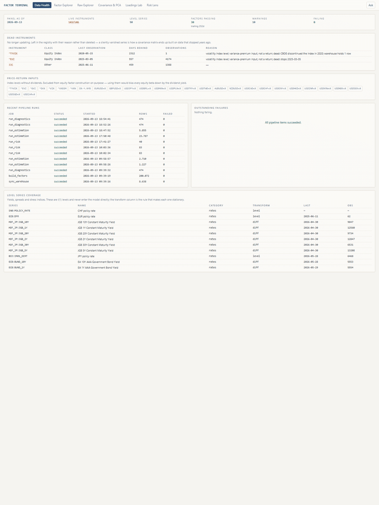

# Daily Multi-Asset Factor Model

A fully return-based factor model: forty daily factors across nine blocks, plus
eleven sector factors a single stock may add for its own sector, with an
analyst frontend for inspecting factors, the covariance structure, rolling
loadings, and — the point of the exercise — whether the model's predicted risk for
a security is actually right.

No holdings, no look-through. Every model input is a stationary return series, and
that is tested rather than assumed. Which model a security gets is not a choice
the analyst makes by hand either: a **model agent** searches the specification
space, picks the simplest model the data cannot tell apart from the best, and
judges it on a span of history the search never saw.



*Overview, Factor Explorer, Raw Explorer, Covariance & PCA, Loadings Lab, Risk
Lens, Operations, Data Health. Regenerate with
`python -m scripts.capture_screenshots` while the app is running.*

**[Watch the film](screenshots/factor-terminal-film.mp4)** — 2m 21s, narrated,
through all eight tabs. Recorded from the running app rather than mocked up, so
what it shows is what the repository does. There is also a
**[sales-desk cut](screenshots/factor-terminal-film-floor.mp4)** of the same
tour, 2m 29s: deeper voice, faster read, a pulse under it instead of a pad.

Rebuild either with `python -m scripts.make_film --cut house|floor`. The
narration is synthesised first and the recording is then timed to it, so the
picture holds each page for exactly as long as its line takes to say; the voice
is Microsoft's neural TTS, which means the script text leaves the machine on the
way to their endpoint. The music is generated in `scripts/make_film.py` rather
than licensed — `--music` takes a wav or mp3 if you hold rights to something
better. `python -m scripts.record_tour` produces the same tour silently.

The two cuts differ in register, not in claims. The floor cut sells hard, but it
never says the model predicts a return, because it does not: it forecasts risk,
and a promo that contradicted the product would be the one thing here that was
not checkable.

The risk model still predicts no returns. The **Return Forecasts** page, added
after the film, is the one place that does, and only at ten years: capital market
assumptions built from yields, growth and valuation beside the risk model, not by
it, and scored on 150 years of public data rather than asserted.

**[Documentation/return-based-multi-asset-factor-model.md](Documentation/return-based-multi-asset-factor-model.md)**
is the model write-up: what each block needs, what the data actually supported, the
decisions taken where the two differed, and the measured validation.
**[Documentation/factor-formulas.md](Documentation/factor-formulas.md)** gives every
one of the factors as a formula over named instruments, with the exact equation
that orthogonalises it.
**[Documentation/factor-model-paper.pdf](Documentation/factor-model-paper.pdf)** is
the same material typeset as a paper, with a flowchart of how the terminal works,
the statistical methodology as an appendix, and a chapter on the software
architecture.
**[Documentation/amzn-case-study.pdf](Documentation/amzn-case-study.pdf)** works one
security end to end on both factor panels — eleven charts, and the argument for the
hierarchy made out of sample on a single name.
**[Documentation/model-agent.md](Documentation/model-agent.md)** is the agent:
the LangGraph workflow, the search space, the validation/test protocol, the model
confidence set and the verdict's gates.
**[Documentation/methodology-review.md](Documentation/methodology-review.md)** is
the October 2026 review of the model, measured on the live database: what was
wrong with how the risk forecast was scored, what was wrong with the forecast,
what was fixed and what is still open.
**[Documentation/return-forecasts.md](Documentation/return-forecasts.md)** is the
Return Forecasts page: the ten-year building blocks, the data and its licences, the
strategic covariance, and the track record on Shiller's US data and the JST panel.

---

## Starting the app

Double-click **`start.bat`**. It starts the API and the web app, waits until both
answer, and opens the browser. On a fresh checkout it also installs the web
dependencies and builds the frontend.

Run it again any time. Anything already serving is left alone rather than started
twice — with one exception it checks for: `next start` reads the build manifest
once, at boot, so rebuilding the frontend while it runs leaves it serving HTML that
points at the previous build's hashed chunks. Those files are gone, so the assets
404 — a missing stylesheet renders the page as unstyled HTML, a missing script
renders nothing at all, and neither reports anything. Port-probing cannot see it,
because the server answers 200 perfectly well. So the script asks every route for
its HTML, follows every asset each one references, and restarts the web app when
any of them fails to resolve. The route list comes from the prerendered pages on
disk, so adding a page cannot leave it unchecked.

After a `git pull`, run it again and it runs the pulled code. Each part records
the git tree it was built or started from. The API is restarted if `backend/`
has changed since it started, the frontend is rebuilt if `frontend/` has changed
since its build, and the web dependencies are reinstalled if the lock file has
changed. Only committed changes count; for live edits use the commands below.
The first run after this was added restarts and rebuilds once, since nothing
had been recorded yet.

To stop, close the two minimised *Factor Terminal* windows.

---

## First-time setup

**[HowToSetupTerminalLocally/](HowToSetupTerminalLocally/)** is the full manual —
PostgreSQL per platform, the database, the foreign-data wrapper, troubleshooting,
and a guided bootstrap:

```bash
python HowToSetupTerminalLocally/bootstrap.py
```

It checks the prerequisites, creates the database, applies the fifteen migrations,
and then tells you which command to run next. Its companion
**[ARCHITECTURE.md](HowToSetupTerminalLocally/ARCHITECTURE.md)** documents the
schema table by table, the backend layering, and the contract the warehouse has to
satisfy if you want to point the model at your own —
**[typeset as a PDF](HowToSetupTerminalLocally/architecture.pdf)**, with the
system and the request lifecycle drawn as diagrams.

The same thing by hand:

```bash
python -m venv .venv && .venv/Scripts/pip install -r requirements.txt
cp .env.example .env
python -m backend.pipeline.apply_schema          # create the DB, apply migrations
python -m backend.pipeline.sync --full           # mirror the warehouse over FDW
python -m backend.pipeline.ingest_yahoo --full   # refresh the factor universe
python -m backend.pipeline.ingest_fred --full    # FRED levels
python -m backend.pipeline.build_factors         # construct the 40 + 11 sector factors
python -m backend.pipeline.run_diagnostics       # stationarity battery
```

Then let the agent choose and score a security's model:

```bash
python -m backend.pipeline.sync --security US:AAPL
python -m backend.agent.run --instrument US:AAPL          # --no-llm: rules only
```

and test whether the model's risk aggregates across a universe of 54 large caps:

```bash
python -m backend.pipeline.run_portfolio                  # --dry-run: store nothing
```

or estimate and score a hand-set specification:

```bash
python -m backend.pipeline.run_estimation --instrument US:AAPL --window 252 --step 1m
python -m backend.pipeline.run_risk --instrument US:AAPL --horizon 21
```

`start.bat` handles the servers, but to run them by hand — with live reload on the
frontend, say:

```bash
.venv/Scripts/python -m uvicorn backend.app.main:app --port 8100
cd frontend && npm run dev                     # http://localhost:3100
```

## Keeping the data current

Three ways to run the same chain — mirror the warehouse, fetch Yahoo and FRED,
re-check coverage, rebuild all forty factors on both bases, re-run the stationarity
battery. It stops at the first fatal failure, because a factor built on
half-refreshed inputs looks current and is not. About two minutes.

**From the app.** The **Operations** tab: one button, *Update all series*. The six
stages fill in as a checklist, the scheduler's own log streams underneath, and the
page shows how many days behind the panel each layer of the model is — so the
question that comes before the button is answered on the same screen.

**Once, from a shell:**

```bash
python -m backend.pipeline.scheduler --once
```

**As a daemon**, which runs it at 23:00 local — after the US close and the FRED
daily refresh, before midnight so the run is stamped with the day whose data it
fetched:

```bash
python -m backend.pipeline.scheduler
```

The exit code is meaningful: non-zero means a fatal stage failed. A refresh does
*not* re-estimate loadings or re-score risk — both are per-specification and are
computed on demand — and does not back-fill a restated history, which is what
**Full rebuild** (`--full`) is for.

---

## Layout

```
sql/            19 idempotent migrations, applied in order, fail-fast
backend/
  core/         pure numpy — no database access, so every statistic is testable
                stationarity · transforms · orthogonalize · regression
                covariance · risk · distribution · returns
  pipeline/     ingestion, construction and estimation jobs
  agent/        the model agent: a LangGraph search over specifications
  app/          FastAPI: thin routers over raw SQL, plus the DeepSeek assistant
  tests/        517 tests, mostly against simulated data with known parameters
frontend/       Next.js 14 + Plotly, nine pages
scripts/        model probe, backfills, screenshots, the narrated film, and the
                two document builds
HowToSetupTerminalLocally/
                install manual, schema reference, and a guided bootstrap
```

The `backend/core` boundary is the main design decision. Every statistical routine
is a pure function over arrays, which is what makes the accuracy claims checkable:
the tests feed each one a process whose truth is known and assert it reaches the
right answer.

---

## Data

The model reads from the `xbrl_sec` warehouse over `postgres_fdw` and writes to its
own `factors` database. Where the warehouse was insufficient, this project fetches
directly:

| Gap found | Fix |
|---|---|
| Equity block had only price-return index levels | Added 12 total-return ETFs (ACWI, IVV, IWM, EFA, VGK, EWJ, EEM, …) |
| No daily gilt curve anywhere | `IGLT.L` as a total-return proxy |
| Liquidity block thin (TED and LIBOR-OIS discontinued) | Added SOFR, EFFR, OBFR, TGCRRATE, NFCI, ANFCI, STLFSI4 |
| FRED dates NFCI by its reference Friday, five days before publication | First releases from ALFRED, stored on their publication dates (`FRED:NFCI@release`) |
| No industry structure | Eleven SPDR sector ETFs as sector factors, one per GICS sector |
| Warehouse 3 months stale, ingestion manual | Own scheduled refresh; data is current |

Three series are dead and flagged rather than deleted: `^TYVIX` (discontinued 2020),
`^EVZ` (stops 2025-03), `JJC` (stops 2025-06). A liveness gate re-checks nightly.

---

## Methodology notes

Things that are easy to get wrong and are handled deliberately:

**Total return, not price return.** Yahoo `^`-prefixed index levels carry no
dividends; using them as equity factors biases every beta down by the dividend
yield. They are marked `is_total_return = false` and excluded from construction.

**Commodity futures.** Yahoo `=F` series are stitched front-month prices with a jump
at every roll — not a return series. A commodity return is the spot move plus the
roll plus the collateral yield, so the commodity block uses total-return ETFs,
which include all three.

**Low-frequency macro is never forward-filled.** A weekly series filled into a daily
regressor manufactures information and understates standard errors: the filled days
carry no news, yet the regression counts them as independent observations. Such
series become sparse release-event factors: the standardised change lands on the
publication day and the factor is exactly zero in between.

**Orthogonalisation is causal.** The block hierarchy is applied on a trailing
504-day window, refitted monthly. Full-sample residualisation would be exactly
orthogonal but would put future information into historical factor values — which
would flatter the model precisely where it is being judged. Measured residual
correlation: rolling −0.05, expanding −0.34, full-sample 0.00.

**The trading calendar excludes crypto.** Crypto prices seven days a week, which
added 1,229 weekend rows on which every other factor is missing. Left in, it made
252-row windows span fewer than 252 trading days and pushed equity factors below the
coverage threshold in the covariance matrix.

**Published factors validate, they never drive.** Fama-French and AQR lag by one to
two months and cannot feed a daily model. They are kept to confirm the in-house
constructions measure what their names claim: `eq_global` vs Mkt-RF r = 0.96,
`eq_size` vs SMB r = 0.93, `sty_momentum` vs Mom r = 0.62, and value/momentum
reproduce their well-known negative correlation.

**Ill-conditioned windows are excluded from scoring.** With 40 factors on a 252-day
window, a period where few factors yet exist leaves the design near-singular; betas
explode in offsetting pairs and so does β′Σβ. Such forecasts are stored and flagged,
not silently dropped or silently used. The condition number is computed on
standardised regressors - on the raw columns it mostly measured how far apart the
factor volatilities are - and its limit applies to both factor panels; the VIF
limit only to the orthogonalised one, where a high VIF is anomalous rather than — as
on the raw panel — the definition of the factor set.

**Every forecast is compared with one that needs no factor model.** The security's
own EWMA volatility and a one-factor CAPM are scored beside the model with QLIKE
loss and a Diebold-Mariano test. The review found that, before the fixes, the
40-factor forecast lost to the security's own EWMA volatility for five of six
names since 2014; a calibrated forecast that cannot beat that has not earned its
factors.

**Risk is tested where it aggregates.** A single security's total volatility cannot
show whether the off-diagonal structure is right, so `run_portfolio` forecasts 54
portfolios of 54 large caps - market, sector baskets, within-sector pairs,
cross-sector spreads, random baskets - and scores them. Without sector factors
the out-of-sample residuals of stocks in one sector correlate 0.22 and only 27% of
cross-sector spreads are calibrated at the 21-day horizon; with each stock's own
sector factor, −0.01 and 82%.

**A release is dated by its publication.** FRED files the NFCI under the Friday
ending its reference week; it is published the following Wednesday. On the Friday
dating the factor correlated −0.33 with the equity returns of the five days before
anyone knew it, so it is read from ALFRED as first releases on their publication
days.

**A forecast built on noisy betas overstates risk.** E[β̂′Σβ̂] = β′Σβ + tr(ΣV), and
with forty factors on 252 days the second term is about a sixth of the specific
variance. Fits keep the covariance of their betas so the term can be removed.

**Any security the warehouse prices can be estimated.** The Loadings Lab searches
a catalogue of 9,434 securities — 5,376 US equities, 3,878 Japanese, 107 funds —
not the 198 already mirrored. Picking one that has never been pulled syncs it on
the first estimate, which is one indexed read. The catalogue is materialised by the
nightly sync because deriving it means aggregating two price tables of fifteen
million rows apiece; searching it live would cost eight seconds a keystroke.

**Green and red are a claim, not decoration.** Colour on a diagnostic says whether
the number is what the model wants, and the rule lives in one file
(`frontend/src/lib/verdict.ts`) so the Factor Explorer and the Raw Explorer cannot
colour the same p-value differently. There are three tones, and the third carries
the weight: green where the test says what we want, amber where it flags something
nothing is gated on, and plain where the outcome is expected. A rejected ARCH-LM or
Jarque-Bera test is never red — volatility clustering and fat tails are the normal
condition of a daily return series, and a GARCH process is strictly stationary. Only
the joint ADF × KPSS verdict, a wrong VaR breach count, and a design past the
condition-number limit earn red.

**The model estimates on either factor panel.** Raw factors or block-hierarchy
residuals, chosen per spec and carried through to the covariance matrix, because
β′Σβ needs Σ to be the covariance of the same series the βs refer to. Both are
offered because the choice is a modelling decision rather than a fact, and the
agent tries both. On US:AAPL the raw panel fits better in sample (adj. R² 0.481 vs
0.441) and forecasts distinctly worse out of it (Mincer-Zarnowitz slope 0.33 vs
0.93), and its loss is significantly worse than the security's own EWMA volatility
(Diebold-Mariano p = 0.015), which the orthogonalised panel's is not. That is the
case for the hierarchy, made out of sample.

---

## The model agent

The Loadings Lab opens on **Run the model agent**. For the chosen security it:

1. splits the history into a validation span and a held-out test span - the last
   three years of monthly forecasts - and hands the search a copy of the data that
   ends before the test span begins;
2. seeds the original model and one departure along each axis that matters, then
   lets a language model (DeepSeek, or a rule-based critic without a key) propose
   further specifications from a typed search space - panel, factor set, window,
   weighting, estimator, Dimson lags, standard errors, the stock's own sector
   factor, covariance, specific risk, noise correction, refresh, VaR distribution -
   reading every candidate's diagnostics as it goes, and carrying in what earlier
   runs chose for this security and for securities like it;
3. scores every candidate on the daily loss of the forecast in force and keeps the
   model confidence set of those the data cannot tell apart from the best;
4. chooses how many lags of cross-day factor covariance the h-day forecast needs,
   on the validation span's h-day returns;
5. takes the simplest of them to the test span once, and gives a verdict - pass,
   pass with caveats, or fail - with the number behind every gate.

The language model chooses what to try; code fits, scores, selects and judges. The
trace, every candidate and the verdict are on the page as the search runs, and
the hand-set controls remain under *Expert override*. See
[model-agent.md](Documentation/model-agent.md).

---

## Portfolio risk

The Risk Lens has a second view, **Portfolio**, which runs the model on a portfolio
of stocks and funds rather than on one security. Start from a pre-defined
portfolio (54 large caps, mega-cap technology, defensive, cyclical,
rate-sensitive), one of eleven sector portfolios (five large caps each, against
the sector's SPDR fund), or a fund portfolio (60/40, global multi-asset,
all-weather, US sectors, global equity by region). Or build one: stocks come from
the catalogue search, funds from a list filtered by asset class. **Broad market
representatives only** keeps the 26 funds that stand for a whole market or asset
class (VT, SPY, EFA, EEM, AGG, BNDX, LQD, JNK, EMB, GSG, GLD and the like);
**Hide factor inputs** drops the funds a factor is built from, which are regressed
on a factor made of themselves.

Each holding is estimated once on its asset-class template, and the fit is
stored: a stock with its own sector factor, a sector fund with its sector's, a
bond fund on rates and credit. The portfolio's risk is then forecast day by day
from the factor covariance, the holdings' specific risks and the beta-noise
correction. The forecast is scored on the portfolio's own returns: bias statistic,
dispersion of standardised returns, VaR breaches with Kupiec, and QLIKE against
the portfolio's own EWMA volatility. The view also decomposes the risk by holding
and by factor block, and against a benchmark fund it gives the tracking error.

Two first results show what the view is for. Five large technology stocks against
XLK: bias statistic 0.99, 99% VaR breaches 51 against 41 expected (Kupiec
p = 0.12), and a tracking error of 22%. Most of that is specific risk, and ORCL
alone, at 61% realised volatility, carries 42% of the variance. The global
multi-asset fund portfolio is the harder case. Its bias statistic is 1.69, but
0.91 once the 21-day block that began on 21 February 2020 (z = −17) is removed,
so the view shows both figures. It also loses to its own EWMA volatility on daily
loss (DM p = 0.005), and the view shows that too.

---

## Return forecasts

**Return Forecasts** (`/returns`) forecasts thirteen asset classes over ten years
from building blocks: a fund's distribution yield, real growth per share measured
on Shiller's data since 1871, the 10-year breakeven, and a valuation change toward
each market's own history. The US valuation uses Shiller's CAPE, Europe and Japan
use Barclays' country CAPE, and EM and REITs their dividend yield. Bonds earn their
starting yield, roll-down and hedge carry, less default losses. Every block shows
its source and date, every judgement is an editable assumption stored with the
run, and the result is a band from a Monte Carlo rather than a point.

Four views:

- **Building blocks**: each class block by block, with its band and the fund's own
  history beside it.
- **Implied vectors**: what the market, 1/N and minimum-variance portfolios would
  have to believe, from μ = λΣw, plus hand-entered published CMAs.
- **Perspectives**: two-stage weights between the vectors, a frontier under each,
  and every fund preset scored under every vector.
- **Track record**: the method rebuilt month by month on Shiller's US data, the JST
  panel of 16 countries and Barclays' CAPE since 1982, each against the historical
  mean.

The weights are the user's: a ten-year horizon leaves no held-out span for the
model agent to judge on.

The external files (Shiller, Barclays, JST) are downloaded by hand into
`data/external/` and loaded with `python -m backend.pipeline.ingest_external`. Two
of the three are licensed for internal or non-commercial use only, so they are
never committed, and the page prints their terms. Results are in
[Documentation/return-forecasts.md](Documentation/return-forecasts.md).

The track record does not flatter the method:

| Test | Result |
|---|---|
| US, out-of-sample R² against the historical mean | +0.06 from 1901, not significant |
| US, the last decade as a forecast | significantly worse than the mean (DM t 4.0) |
| Bonds, starting yield against the next decade | correlation 0.95 |
| JST panel, dividend-yield reversion | lost to the mean, OOS R² −0.19 ex US |

---

## The assistant

The **Ask** panel answers questions about the methodology and about the numbers on
the page in front of you. It runs on DeepSeek and is grounded two ways: a
methodology corpus assembled at startup from the module docstrings in
`backend/core/` and the `note` field on every factor in `backend/pipeline/
factor_defs.py`, and a snapshot of exactly what the open page has rendered.

It has no tools and no database access of its own, which is deliberate. The system
prompt makes the supplied figures authoritative over the model's own arithmetic, so
asked for something that is not in view it names the page that produces it rather
than estimating. Three live tests hold it to that.

Set `DEEPSEEK_API_KEY` in the environment. `python -m scripts.probe_deepseek` checks
which model actually returns text with the full corpus in the prompt — worth running
before changing `DEEPSEEK_MODEL`, since the reasoning tiers can spend their whole
output budget on hidden reasoning and return nothing.

---

## Stationarity

A single ADF test is useless as a gate — on daily returns it rejects almost always.
The battery is built to catch what actually goes wrong:

| Test | Catches |
|---|---|
| ADF × KPSS, read jointly | A level that should have been differenced |
| Zivot-Andrews | A structural break masquerading as a unit root |
| Lo-MacKinlay variance ratio | Stale or smoothed pricing |
| Ljung-Box | Autocorrelation, the second stale-pricing signal |
| ARCH-LM | Volatility clustering — **recorded, never gated**: a GARCH process is strictly stationary |
| Zero-return share | Illiquidity; the cheapest and often most telling check |

The ADF × KPSS cross gives four verdicts rather than one: stationary, unit root,
break-or-heteroskedasticity, or inconclusive. Only the second blocks a series.

---

## Verification

```bash
python -m pytest -q                       # 447 pass; 3 more call the live DeepSeek API (FACTORS_LIVE_LLM=1)
python -m pytest backend/tests/test_factor_validation.py   # needs a populated DB
```

The unit tests do not merely check that functions return numbers. Each feeds a
process with known properties and asserts the right conclusion: a random walk must
fail, an AR(1) with φ=0.5 must pass, a GARCH series must flag ARCH effects without
failing, a smoothed series must show a variance ratio above 1, a halved volatility
forecast must produce a bias ratio of 2, and clustered VaR breaches must be caught
by Christoffersen even when Kupiec sees nothing wrong with the count.

Two bugs were found this way and would not have been found otherwise: `arch`'s
`VarianceRatio` consumes a price level and differences internally, so passing
returns gave VR ≈ 1/q and flagged every clean factor as mean-reverting; and the
ridge penalty was scaled by σ⁻² instead of σ², which shrank every loading to zero at
λ = 1.
